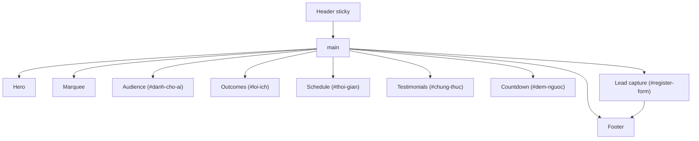

# Blueprint trang `/test1` — Content That Sells

> **Mục đích:** Mô tả **cấu trúc, nội dung, màu sắc, logo, form và hành vi** của landing `/test1` để có thể **nhân bản cùng layout** với **chủ đề / sự kiện mới** (đổi copy, ảnh, ngày giờ, API đăng ký) mà không phải đọc lại toàn bộ code.

> **Lưu ý:** `docs/web-style-guide.md` mô tả DNA thương hiệu **MAKE IT LAUNCH** (nền xanh + vàng) từ repo gốc. Trang `/test1` trong repo này dùng **variant poster đen** — tài liệu này là nguồn chân lý cho `/test1`.

---

## 1. Tổng quan route & file

| Mục | Giá trị |
|-----|---------|
| **URL** | `/test1` |
| **Page** | `app/test1/page.tsx` |
| **Shell (thứ tự section)** | `components/landing/test1/test1-shell.tsx` |
| **SEO** | `robots: noindex, nofollow` (trang test) |
| **Ngôn ngữ** | `lang="vi"` (root layout) |

### 1.1 Sơ đồ section (từ trên xuống)



| # | Section | Component | Anchor `id` | Variant nền |
|---|---------|-----------|-------------|-------------|
| — | Header | `components/landing/header.tsx` | — | sticky đen mờ |
| 1 | Hero | `components/landing/hero.tsx` | — | `mesh` |
| 2 | Marquee | `components/landing/social-proof-marquee.tsx` | — | band trắng |
| 3 | Đối tượng | `test1/audience-section.tsx` | `#danh-cho-ai` | `elevated` |
| 4 | Lợi ích | `test1/outcomes-section.tsx` | `#loi-ich` | `base` |
| 5 | Lịch & chi phí | `test1/schedule-section.tsx` | `#thoi-gian` | `elevated` |
| 6 | Chứng thực | `test1/testimonials-section.tsx` | `#chung-thuc` | `base` |
| 7 | Đếm ngược | `test1/countdown-section.tsx` | `#dem-nguoc` | `elevated` + orbs |
| 8 | Form đăng ký | `components/landing/lead-capture.tsx` | `#register-form` | `mesh` + orbs |
| — | Footer | `components/landing/footer.tsx` | — | nền đen |

**Nav trong header (`test1-shell`):**

| Nhãn | Hash |
|------|------|
| Đối tượng | `#danh-cho-ai` |
| Lợi ích | `#loi-ich` |
| Thời gian | `#thoi-gian` |
| Feedback | `#chung-thuc` |

Hero nút phụ “Xem nội dung chương trình” scroll tới `#loi-ich` (`programHash`).

---

## 2. Thương hiệu, logo & media

### 2.1 Logo & tên hiển thị

| Asset | Path | Dùng ở |
|-------|------|--------|
| Logo 10X | `/10x-logo.png` (`BRAND_LOGO_SRC`) | Header 40×40, Footer 32×32 |
| Poster hero (peephole) | `/hero-peephole.jpg` (`WORKSHOP_POSTER_SRC`) | Hero — ảnh tròn diễn giả |
| Feedback screenshots | `/feedback1.png` … `/feedback8.png` | Testimonials |

**Header branding:**

- Dòng phụ (desktop): `10X Masterminds` — uppercase, tracking rộng, màu subtle.
- Dòng chính: component `MakeItLaunchTitle` size `header` — chữ **MAKE IT LAUNCH** + class `text-gold-shimmer`.

**Footer:** `© 2026 10X Masterminds · MAKE IT LAUNCH` + link Facebook (`FACEBOOK_PAGE_URL` trong `lib/constants.ts`).

### 2.2 Chủ đề sự kiện hiện tại (placeholder khi clone)

| Trường | Giá trị mẫu |
|--------|-------------|
| Tên workshop | **Content That Sells** |
| Tagline hero | Free Workshop Online |
| Diễn giả | Mrs. Thao Tran — Cố vấn Hệ thống Nội dung Chuyển đổi |
| Thời gian | 9h00 – 11h00, Thứ 7, 31/10/2026 |
| Nền tảng | Zoom (online), GMT+7 |
| Giá | Miễn phí 100% |

---

## 3. Design tokens (poster đen — `app/globals.css`)

### 3.1 Bảng màu

| Token | Giá trị | Vai trò |
|-------|---------|---------|
| `--background` | `#000000` | Body, viền peephole |
| `--foreground` | `#ffffff` | Chữ chính, tiêu đề |
| `--color-text-muted` | `#b3b3b3` | Body, mô tả |
| `--color-text-subtle` | `#8a8a8a` | Label phụ, số thứ tự |
| `--color-surface` | `#0a0a0a` | Section `elevated` alt |
| `--color-surface-elevated` | `#141414` | Card, form panel |
| `--color-border` | `rgba(255,255,255,0.12)` | Viền card, input |
| `--color-border-strong` | `rgba(255,255,255,0.28)` | Nút outline, footer link |
| `--color-accent-gold` | `#d4af37` | Accent tên (shimmer), radio accent |
| `--color-accent-red` | `#e53935` | (Token; CTA chính dùng nút trắng shimmer) |

**Section variants (`components/ui/section.tsx`):**

- `base` → `.bg-poster-section` (nền `#000`)
- `elevated` → `.bg-poster-section-alt` (nền `#0a0a0a`)
- `mesh` → `.bg-mesh-animated` — gradient đen xám animated (Hero, Form)

**Marquee:** nền **trắng**, chữ **đen**, `border-y-2 border-white`, animation `.marquee-scroll` 42s.

### 3.2 Typography

| Vai trò | Font | Ghi chú |
|---------|------|---------|
| Toàn site | **Inter** (`app/fonts.ts` → `--font-inter`) | `layout.tsx` gắn variable + className |

| Pattern | Class / component |
|---------|-------------------|
| Label section | `.section-label` — 12px, bold, uppercase, tracking 0.18em |
| H2 section | `.section-title` — ~30px desktop, balance |
| Highlight trong title | `<span className="text-gold-shimmer">…</span>` |
| Body | `.text-body` — 16px / 18px md, muted |
| Copy dài tiếng Việt | `.text-justify-vi` |
| Hero H1 | `text-4xl` → `sm:text-5xl`, extrabold; từ “Sells” shimmer |

### 3.3 Card & hiệu ứng

| Class | Mô tả |
|-------|--------|
| `.card-surface` | Bo 1rem, nền elevated, viền mờ, hover sáng viền + shadow |
| `ShineCard` | Card + sweep ánh sáng khi hover (Outcomes) |
| `AmbientOrbs` | Hero: `variant="hero"`; Countdown + Form: `variant="cta"` |
| `.peephole-ring` / `.hero-peephole-*` | Khung tròn ảnh diễn giả + caption gradient |
| `.hero-event-badge` | Glass bar thời gian / địa điểm dưới ảnh |
| `.glow-pulse-red` + `.btn-shimmer` | CTA đăng ký (nền trắng, chữ đen) |

### 3.4 Layout chuẩn

| Pattern | Giá trị |
|---------|---------|
| Container | `SectionContainer` — `container mx-auto px-4 md:px-8` |
| Wide content | `width="wide"` → `max-w-5xl` |
| Section padding | `py-16 md:py-24`, `scroll-mt-24 md:scroll-mt-28` |
| Scroll offset JS | `HEADER_OFFSET = 88` (`lib/scroll-to-section.ts`) |
| Grid 2 cột | `lg:grid-cols-2`, gap 6–16 tùy section |
| Outcomes grid | `md:grid-cols-2 lg:grid-cols-3` |

---

## 4. Chi tiết từng section (nội dung & cấu trúc UI)

Dùng bảng dưới như **template copy** — thay `[CHỦ ĐỀ]`, ngày giờ, bullet khi làm sự kiện mới.

### 4.1 Hero

**Layout:** 2 cột lg — trái copy + CTA, phải peephole + event badge.

**Copy mẫu:**

- Label: `Free Workshop Online`
- H1: `Content That` + shimmer `Sells`
- Mô tả: chủ đề chuỗi content chuyển đổi cao → sự kiện bán hàng
- Trust bullets (3 dòng, icon ✓ vòng `bg-white/15`):
  - 100% miễn phí…
  - Framework đã dùng launch thật
  - Tặng template + checklist
- CTA primary: `RegisterCtaButton` → scroll `#register-form`
- CTA secondary: outline “Xem nội dung chương trình” → `#loi-ich`
- Urgency: “Chỉ còn vài suất — ưu tiên người đăng ký sớm”

**Visual phải:** ảnh fill peephole, caption tên + role; badge glass 2 hàng (Thời gian | Địa điểm).

### 4.2 Social proof marquee

**Mảng chuỗi lặp (scroll vô hạn):** ví dụ `CONTENT-FUNNEL`, `10X MASTERMINDS`, `MAKE IT LAUNCH`, … — **uppercase**, tracking 0.22em, đen trên trắng.

### 4.3 Audience (`#danh-cho-ai`)

**Intro:** label “Đối tượng”, title có shimmer “không dành cho ai”, mô tả center.

**2 card cạnh nhau:**

| Card | Tiêu đề phụ | List |
|------|-------------|------|
| Dành cho bạn nếu | “Bạn đang cần khách đến sự kiện” | 4 bullet ✓ (vòng trắng, chữ đen) |
| Chưa phù hợp nếu | “Bạn tìm một thứ khác” | 4 bullet × (viền tròn) |

Card trái: `border-white/20` nhấn mạnh.

### 4.4 Outcomes (`#loi-ich`)

**Intro:** “Bạn nhận được những gì?”

**Grid 6 `ShineCard`:** mỗi card có số `01`–`06`, title, body (justify VI).

Chủ đề mẫu: Framework CONTENT-FUNNEL, Hook/CTA, lịch 7–14 ngày, 5 dạng bài, template, Q&A + Zalo.

### 4.5 Schedule (`#thoi-gian`)

**2 card:**

1. **Thời gian:** giờ lớn, ngày + Zoom; timeline 3 block (45/45/30 phút) với số thứ tự ô vuông trắng.
2. **Thanh toán:** `0đ`, bullet check trắng (`CheckCircleIcon`), disclaimer recording, `RegisterCtaButton` full width mobile.

### 4.6 Testimonials (`#chung-thuc`)

**Grid 2 cột:** mỗi item = tên + kết quả + ảnh screenshot (click mở lightbox).

**Lightbox:** portal `z-[100]`, overlay đen 80%, Escape / mũi tên / nút Trước-Sau, swipe hint mobile.

### 4.7 Countdown (`#dem-nguoc`)

**State machine:**

- `START` / `END` ISO +07:00
- Phase: `upcoming` | `live` | `ended`
- Upcoming: 4 ô Ngày/Giờ/Phút/Giây + CTA
- Live / ended: copy thay title + khối “Khung giờ đã chốt”

### 4.8 Lead capture (`#register-form`)

**Layout:** 2 cột lg — trái headline + bullet quà; phải form **sticky** (`top: 6.5rem` desktop).

**Copy trái:**

- Label: “Giữ chỗ ngay”
- H2: “Đăng ký” + shimmer tên sự kiện
- 3 bullet ✓ (giờ, Zoom miễn phí, quà)

---

## 5. Form đăng ký (`RegisterForm`)

**Wrapper:** `.kit-form-wrapper.kit-form-wrapper--dark` — `rounded-2xl`, nền `rgba(18,18,18,0.85)`, backdrop blur.

### 5.1 Luồng 2 bước

| Bước | Trường | Bắt buộc |
|------|--------|----------|
| **1** | Họ tên, SĐT, Email | * |
| **2** | Ngành kinh doanh (text) | * |
| **2** | Quy mô team (radio) | * |
| **2** | Doanh thu/tháng (radio) | * |
| **2** | Vấn đề muốn giải quyết (text) | * |

**Radio options** (`lib/sbo-event-form-fields.ts`):

- Team: `1 mình tôi` | `Dưới 5 người` | `Từ 5-10 người` | `Trên 10 người`
- Doanh thu: `Dưới 20 triệu` | `Từ 20-50 triệu` | `Từ 50-100 triệu` | `Trên 100 triệu`

**Nút:**

- Bước 1 submit → “Tiếp tục”
- Bước 2 → “Quay lại” (secondary) + “Đăng ký tham gia” (red variant = shimmer trắng)
- Indicator: `Bước x/2` + thanh progress trắng

**Sau submit thành công:** `LeadSuccessModal` — link **group Zalo** (`redirectTo` API hoặc `EVENT_ZALO_GROUP_URL`).

### 5.2 API & custom fields

| Biến môi trường | Fallback |
|----------------|----------|
| `NEXT_PUBLIC_SBO_EVENT_REGISTER_URL` | URL SBO event trong `lib/constants.ts` |
| `NEXT_PUBLIC_EVENT_ZALO_GROUP_URL` | Link Zalo group mặc định |

Custom field UUID gửi kèm payload: xem `SBO_CUSTOM_FIELD_IDS` trong `lib/sbo-event-form-fields.ts` (đồng bộ ERP — đổi sự kiện mới cần map field mới).

**CTA toàn trang:** `CTA_REGISTER_HREF = "#register-form"` — mọi `RegisterCtaButton` scroll tới form.

---

## 6. Nút & tương tác

| Component | Hành vi | Style |
|-----------|---------|--------|
| `RegisterCtaButton` | Scroll `#register-form` | `variant="red"` + `rounded-full` + glow trắng |
| `Button outline-light` | Scroll hash / secondary | Viền strong, hover bg white/10 |
| Header nav | `scrollToHash` + đóng mobile menu | Pill track desktop |
| Reveal / Stagger | Framer entry animation | Bọc intro và grid items |

---

## 7. Checklist clone sang chủ đề mới

### 7.1 Copy & nội dung

- [ ] Metadata `app/test1/page.tsx` (hoặc route mới): title, description
- [ ] Hero: H1, mô tả, trust bullets, urgency, caption diễn giả
- [ ] Marquee: 6–8 keyword chủ đề mới
- [ ] Audience: 2 list “for / not for”
- [ ] Outcomes: 6 (hoặc N) benefit cards
- [ ] Schedule: ngày giờ, agenda blocks, giá / free copy
- [ ] Testimonials: ảnh + tên + kết quả (file trong `public/`)
- [ ] Countdown: cập nhật `START` / `END` trong `countdown-section.tsx`
- [ ] Lead capture bullets + modal success (ngày Zalo)
- [ ] Footer năm / tên chương trình nếu đổi

### 7.2 Media & brand

- [ ] Thay `WORKSHOP_POSTER_SRC` hoặc file ảnh hero
- [ ] Giữ hoặc thay `BRAND_LOGO_SRC` (10X)
- [ ] OG image trong layout/metadata nếu cần

### 7.3 Kỹ thuật

- [ ] Tạo route mới: `app/[slug]/page.tsx` + shell (copy `test1-shell.tsx`)
- [ ] Chỉnh `navLinks` hash khớp `id` section
- [ ] Event API + `SBO_CUSTOM_FIELD_IDS` cho form ERP mới
- [ ] Env Zalo group URL
- [ ] Bật `robots index` khi production (test1 đang noindex)

### 7.4 Giữ nguyên “DNA layout”

- [ ] Thứ tự section như bảng §1.1 (có thể bỏ/ thêm section nhưng giữ pattern Intro → grid/card)
- [ ] Tokens đen/trắng — không đổi sang mesh xanh trừ khi merge với style guide cũ
- [ ] Dùng `Section` + `SectionIntro` + `card-surface` / `ShineCard`
- [ ] Form 2 bước + sticky cột phải desktop

---

## 8. File tham chiếu nhanh

| File | Vai trò |
|------|---------|
| `components/landing/test1/test1-shell.tsx` | Ghép section + nav |
| `app/globals.css` | Màu poster, peephole, form, marquee |
| `lib/constants.ts` | Logo, poster, CTA hash, API, Zalo, Facebook |
| `components/landing/register-form.tsx` | Form 2 bước + submit |
| `docs/dang-ky-cmvolq1j.html` | HTML form ERP tham chiếu field |
| `docs/web-style-guide.md` | Style guide MAKE IT LAUNCH (variant xanh — khác skin `/test1`) |

---

## 9. Prompt gợi ý cho Cursor (sự kiện mới)

```text
Tạo landing page mới theo docs/test1-page-blueprint.md:
- Chủ đề: [TÊN WORKSHOP]
- Ngày: [NGÀY GIỜ +07]
- Diễn giả: [TÊN + TITLE]
- Giữ layout test1-shell, variant poster đen, RegisterForm 2 bước.
- Route: /[slug]
- Cập nhật countdown ISO, marquee keywords, 6 outcomes, audience for/not-for.
- Ảnh hero: public/[file].jpg, feedback: public/feedback-*.png
- API đăng ký: [URL hoặc env]
```

---

*Blueprint trích từ codebase `content-that-sells` — route `/test1`, cập nhật theo implementation hiện tại (Inter, nền đen poster, CTA trắng shimmer).*
